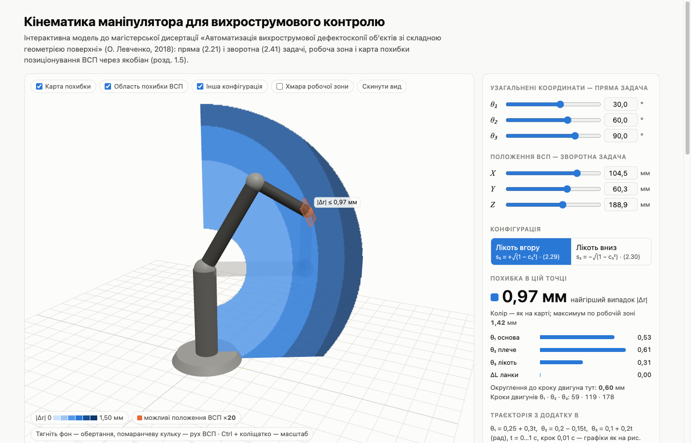

# Кінематика маніпулятора для вихрострумового контролю

[](https://github.com/lev-oxr/manipulator-kinematics/actions/workflows/deploy.yml)
[](LICENSE)

[](https://lev-oxr.github.io/manipulator-kinematics/)

Інтерактивна модель 3-ланкового маніпулятора з магістерської дисертації
«Автоматизація вихрострумової дефектоскопії об'єктів зі складною геометрією поверхні» (О. Левченко, 2018).

**▶ [Відкрити сторінку](https://lev-oxr.github.io/manipulator-kinematics/)**

*English: an interactive 3D model of a 3-link manipulator for eddy-current testing, from the author's 2018 master's thesis. Forward and inverse kinematics, elbow-up/down configurations, a positioning-error map via the Jacobian (stepper microstepping, gear backlash, link tolerance) and a trajectory playback. Plain ES modules and Three.js, no build step.*

## Що можна робити

- **Пряма (2.21) і зворотна (2.41) задачі.** Повзунки кутів θ₁–θ₃ і координат X, Y, Z синхронні; ВСП можна тягнути мишею прямо в 3D.
- **Конфігурація ліктя.** Перемикач «лікоть вгору / вниз» за (2.29)/(2.30), друга конфігурація показана напівпрозорою.
- **Карта похибки позиціонування.** Найгірша похибка |Δr| по всій робочій зоні через якобіан (розвиток розд. 1.5).
  Враховує мікрокрок драйвера A4988, люфт передачі й допуск довжин ланок.
- **Траєкторія з Додатку В.** Відтворення θ(t) з графіками X(t), Y(t), Z(t), як на рис. 2.10, і похибкою |Δr|(t).

Модель: L₁ = L₂ = 120 мм, L₃ = 70 мм; двигуни NEMA17 (1,8°/крок), зубчаста передача 9/32.

## Файли

| Файл | Що всередині |
|---|---|
| `index.html` | сторінка: інтерфейс, 3D-сцена (Three.js 0.160 з jsDelivr), карта похибки, графіки |
| `kin.js` | математика без прив'язки до сторінки: (2.21), (2.41), якобіан, похибка (1.4), траєкторія Додатку В |
| `kin.test.mjs` | самоперевірка: `node kin.test.mjs` → `ok` |
| `docs/` | скриншот для README |

Збирання не потрібне. Workflow `.github/workflows/deploy.yml` запускає тест і публікує на GitHub Pages лише `index.html` і `kin.js`.

## Локальний запуск

Сторінка використовує ES-модулі, тому з `file://` не відкриється — потрібен будь-який локальний сервер:

```bash
python -m http.server 8000
```

і далі http://localhost:8000.

## Ліцензія

[MIT](LICENSE)
